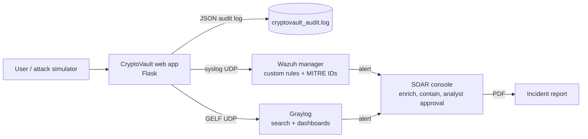

# CryptoVault SOC

A small Security Operations Center (SOC) lab built around a mock crypto-exchange web app.
The app writes a structured security log for everything a user does, ships those logs to two SIEMs
(**Wazuh** and **Graylog**), custom **Wazuh detection rules** raise alerts mapped to **MITRE ATT&CK**,
and a **SOAR console** walks an analyst through containing the incident.

Built as the final project for my SOC course (3rd year, B.Tech CSE, PES University).



## What it does

| Part | What it shows |
|---|---|
| **Web app** (`app/`) | Login, vault dashboard, BTC withdrawal form. Every login, failed login, page view, withdrawal, logout and 404 becomes one JSON event. |
| **Log pipeline** | Each event goes to a local audit file, to Wazuh over **syslog (UDP)**, and to Graylog as **GELF 1.1 (UDP)**. Fields: `timestamp, app_name, log_source, event_type, severity, username, source_ip, details`. |
| **Detection** (`siem/wazuh/`) | 6 custom Wazuh rules (table below), each alert tagged with its MITRE ATT&CK technique. |
| **Attack simulation** | Buttons in the app's *Simulator* page fire one scenario per rule, plus a 4-stage ransomware kill chain. |
| **Response** | *SOAR* page runs a playbook: identification, threat-intel enrichment, automated containment, then **waits for analyst approval** before freezing the hot wallet. Exports a PDF incident report. The playbook is simulated: it logs each step but does not touch a real firewall or wallet. |

## Detection rules

From `siem/wazuh/wazuh_custom_rules.xml`:

| Rule ID | Level | Fires when | MITRE ATT&CK |
|---|---|---|---|
| 100100 | 3 | Any JSON event from `CryptoVault_Frontend` (base rule) | - |
| 100101 | 10 | **Impossible travel**: Active Directory login "from distinct geolocation" | T1078 Valid Accounts |
| 100102 | 3 | DNS query seen by the Palo Alto firewall (base for 100105) | - |
| 100105 | 8 | **Vault beaconing**: 10+ DNS queries from the same source IP within 60 s | T1071.004 DNS C2 |
| 100103 | 12 | **Endpoint malware**: CrowdStrike EDR event (clipboard tampering) | T1115 Clipboard Data |
| 100104 | 12 | **Critical asset transfer**: `WITHDRAWAL_INITIATED` | - |

`local_rules_custom_decoder.xml` + `local_decoder.xml` are the same rules written for a custom regex
decoder instead of Wazuh's built-in JSON decoder. `patch_wazuh.sh` deploys the JSON version.

## Attack scenarios

| Simulator button | Events sent | Triggers |
|---|---|---|
| Rule 1: Impossible Travel | 2 admin logins, one from `185.20.12.99` | 100101 |
| Rule 2: Vault Beaconing | 12 DNS queries to a non-whitelisted IP | 100102, 100105 |
| Rule 3: Clipboard Malware | EDR: clipboard modified, then outbound request | 100103 |
| Ransomware kill chain | Stage 1 PowerShell execution (T1059) → 2 SSH brute force / lateral movement (T1021) → 3 DNS exfiltration (T1048) → 4 mass file encryption (T1486) | Graylog dashboards |
| Withdrawal form (dashboard) | `WITHDRAWAL_INITIATED` | 100104, SOAR playbook |

## Repository layout

```
app/                      Flask web app
  cryptovault_app.py      routes, JSON audit logging, syslog + GELF senders, SOAR API, PDF export
  siem_logger.py          shared helper the attack stages use to send to both SIEMs
  attacks/                kill-chain stages 1-5, incident-containment simulation
  templates/, static/     UI (login, dashboard, simulator, SOAR console)
siem/
  wazuh/                  custom rules, decoder, ossec.conf, patch_wazuh.sh
  graylog/                docker-compose (Graylog 5.2 + OpenSearch + MongoDB), Wazuh -> Graylog integration, filebeat config
tools/                    standalone CLI scripts: kill-chain generator, dashboard populator, terminal SOAR demo
scripts/                  run_with_graylog.sh (one-command local demo), soc_autopilot.sh
samples/                  sample_audit_log.jsonl: 377 real events from a demo run
```

## Run it

**1. App only** (logs go to `cryptovault_audit.log`; SIEM sends fail quietly if nothing is listening)

```bash
python3 -m venv .venv && source .venv/bin/activate
pip install -r requirements.txt
python3 app/cryptovault_app.py        # http://127.0.0.1:5000
```

Demo login: `admin` / `secure123` (local demo only). Any wrong password logs a `LOGIN_FAILED`;
any unknown path logs a `404_NOT_FOUND` recon event.

**2. With Graylog** (needs Docker)

```bash
./scripts/run_with_graylog.sh         # starts Graylog, then the app on port 5001
```

Graylog UI: http://127.0.0.1:9000. Create a **GELF UDP** input on port **12201** if it does not exist yet.

**3. With Wazuh** (Wazuh single-node in Docker, container `single-node-wazuh.manager-1`)

```bash
./siem/wazuh/patch_wazuh.sh           # copies the rules, opens syslog UDP 514, restarts Wazuh
WAZUH_HOST=127.0.0.1 WAZUH_PORT=514 python3 app/cryptovault_app.py
```

Environment variables: `WAZUH_HOST`, `WAZUH_PORT`, `GRAYLOG_HOST`, `GRAYLOG_PORT`, `CRYPTOVAULT_PORT`,
`CRYPTOVAULT_LOG_FILE`, `FLASK_SECRET_KEY`.

Run a single attack stage from the terminal:

```bash
cd app && python3 -m attacks.attack_3_exfiltration
```

## Notes

- All IPs, users and companies in the logs (Active Directory, Palo Alto, CrowdStrike) are simulated log sources; no real systems are involved.
- The demo password and Flask secret are placeholders for a local lab. Set `FLASK_SECRET_KEY` for anything beyond that.

## Tech

Python, Flask, Wazuh, Graylog 5.2, OpenSearch, MongoDB, Docker Compose, syslog, GELF, MITRE ATT&CK, ReportLab (PDF reports).
